# Module 05: MESI/MOESI Cache-Coherence State Diagrams

**Owner:** Vivansh (owner inferred from Module 04 handoff; confirm against the current assignment)  
**Team:** LNCT Qubit — EPAM CoE: Hardware Concurrency, Memory Models & Lock-Free Design  
**Date:** 2026-10-09  
**Previous handoff:** Prachi — Module 04, Cache Coherence  
**Evidence labels:** EXTERNAL EVIDENCE, THEORETICAL, PENDING LOCAL VERIFICATION

> **Scope warning:** These are protocol teaching models grounded in public documentation. They are not a reverse-engineered diagram of the exact cache implementation in the team's CPU. Real implementations can add states, transient states, request types, directories, snoop filters, and implementation-specific rules.

## A. Scope and boundaries

### In scope
- Explain the MESI stable states and their core invariants.
- Give simplified, labeled state-transition diagrams and traces for read sharing, a write after sharing, and competing writers.
- Explain the extra role of the Owned state in MOESI.
- Provide source-backed caveats and a handoff to the integration/benchmark owner.

### Out of scope
- Repeating cache hierarchy/locality (Module 03, Ujjwal).
- Repeating the conceptual cache-coherence introduction (Module 04, Prachi), except where needed to explain transitions.
- Measuring false sharing or claiming hardware-counter observations (Vishwajeet's benchmark).
- Explaining Java synchronization, fences, or lock-free algorithms beyond the boundary note in Section G.

No Java experiment is added: Java source does not directly reveal coherence messages or prove a particular physical state transition. A timing demo alone is not protocol evidence.

## B. MESI stable states

Intel's Software Developer's Manual describes MESI as Modified, Exclusive, Shared, and Invalid for Intel 64/IA-32 cache coherence. The definitions below summarize the stable-state teaching model; exact transaction names and transition rules depend on the implementation.

| State | Valid in this cache? | Other cached copies? | Relation to memory | Local read | Local write |
|---|---|---|---|---|---|
| **M — Modified** | Yes | No other valid copies in the basic model | This cache has newer data; memory may be stale | Allowed | Allowed while permission remains |
| **E — Exclusive** | Yes | No | Clean; agrees with memory | Allowed | Can locally become M without invalidating another copy |
| **S — Shared** | Yes | May exist | Clean in the basic MESI model | Allowed | Must obtain write permission / invalidate conflicting copies |
| **I — Invalid** | No | Other caches may have valid copies | This cache's copy cannot be used | Requires reacquiring a valid copy | Requires obtaining the line/permission |

**Invariants to preserve in the diagram:**
1. M and E are exclusive states in the basic MESI model: another cache does not simultaneously hold a valid copy of that line.
2. S permits multiple readable copies.
3. I means the local cached copy is not valid for ordinary loads.
4. A store to a shared line cannot simply leave other caches treating their copies as current; the protocol coordinates permission and conflicting copies.
5. A line's state is a hardware implementation concept. Java fields are not guaranteed to map one-to-one to cache lines.

## C. Simplified MESI state diagram

This diagram is intentionally a compact teaching model, not a complete transition table for every Intel generation. Arrows represent common stable-state outcomes; requests and transient states are omitted.

```mermaid
stateDiagram-v2
    [*] --> I
    I --> E: Read miss / no other sharer
    I --> S: Read miss / line shared
    I --> M: Write miss / obtain write permission
    E --> M: Local store
    E --> S: Another core obtains a read copy
    E --> I: Another core obtains write permission
    S --> I: Another core obtains write permission
    S --> M: Upgrade / invalidate other copies
    M --> S: Another core reads; data supplied / owner writes back as required
    M --> I: Another core obtains write permission
    M --> E: Not a generic direct transition; implementation-specific writeback/ownership events omitted
```

### How to read the diagram
- **I → E/S:** A read miss obtains a line. If no other cache is known to hold a copy, an exclusive clean copy may be granted; if copies may exist, the line may be shared.
- **E → M:** A local store can use exclusive permission without invalidating another valid copy in the basic model.
- **S → M:** The core must obtain write permission. Other sharers are invalidated or otherwise coordinated before conflicting copies can remain valid.
- **M → S:** A read by another core may cause the modified data to be supplied and the original holder to relinquish exclusive modified status. The exact states and data path vary by implementation.
- **M/S/E → I:** An invalidation or replacement can make the local copy unusable. Replacement is not necessarily a coherence message to other caches.

The arrow labels deliberately avoid assuming a universal bus, request name, acknowledgement scheme, or single data source. A production-level diagram must use the exact selected architecture manual and include transient states if the manual specifies them.

## D. Three event traces

### D1. Read-only sharing

Initial: `x = 0`, both caches begin in I for the line.

| Step | Core C0 | Core C1 | Simplified outcome |
|---|---|---|---|
| 1 | Reads x; I → E if no other sharer is known | I | C0 gets a valid clean copy |
| 2 | Holds E | Reads x; I → S | C1 obtains a copy; C0 is downgraded to S or equivalent protocol outcome |
| 3 | Reads x from its valid copy | Reads x from its valid copy | Both may read without each load fetching from DRAM |

The precise transition and source of data are protocol-dependent. Do not assert that every second read is served directly by C0's private cache.

### D2. C0 writes after both cores read

Initial: both cores hold S copies of the line containing `x = 0`.

| Step | Event | C0 state | C1 state | Meaning |
|---|---|---|---|---|
| 1 | C0 requests write permission / upgrade | S or transient | S or transient | Permission request begins |
| 2 | Coherence system coordinates invalidation | transient | S → I (or protocol-equivalent) | C1's old copy must not remain valid for ordinary reads |
| 3 | Permission granted; C0 stores `x = 1` | M in the simplified model | I | C0 can write under its acquired permission |
| 4 | C1 reads x later | M or implementation-specific response state | I → valid state | C1 reacquires current data through the coherence path |

Do not infer exact acknowledgements, message ordering, or data source from this abstract trace. Those require the selected protocol specification.

### D3. Competing writers

Initial: C0 and C1 repeatedly write the same cache line.

```text
C0 obtains write permission → C0 stores
C1 requests write permission → C0's conflicting copy is invalidated/downgraded
C1 obtains permission → C1 stores
C0 requests permission again → coordination repeats
```

The line may move between cores, generating coherence traffic and latency. This is a conceptual explanation of potential ownership ping-pong, not a measured result and not proof that a specific physical event occurred on the team's machine.

## E. MOESI: what the Owned state adds

MOESI adds **O — Owned** to Modified, Exclusive, Shared, and Invalid. In the common teaching model, O represents a cache holding the authoritative dirty data while the line may also be shared by other caches. The owner is responsible for ensuring the modified data is eventually propagated to memory or otherwise handled according to the implementation. This can allow a dirty line to be shared without immediately writing it back to main memory.

| State | Teaching-model meaning | Important caveat |
|---|---|---|
| **M** | Valid, dirty, exclusive copy | No other valid copy in the basic model |
| **O** | Valid, dirty owner; shared copies may exist | Exact owner responsibilities and transitions depend on the protocol |
| **E** | Valid, clean, exclusive copy | Can often become M on local store |
| **S** | Valid, clean shared copy | May coexist with another sharer or an O owner in MOESI |
| **I** | No valid local copy | A later access must reacquire data/permission |

### Simplified MOESI state illustration

```mermaid
stateDiagram-v2
    [*] --> I
    I --> E: Read miss / no sharer
    I --> S: Read miss / clean shared data
    I --> M: Write miss / exclusive write permission
    E --> M: Local store
    E --> S: Another core reads
    M --> O: Another core reads dirty line; owner retains responsibility
    M --> I: Another core gains write permission
    O --> M: Owner reacquires exclusive write permission
    O --> S: Dirty responsibility resolved / implementation-specific transition
    S --> I: Another core gains write permission
    S --> M: Upgrade and invalidate sharers
    O --> I: Ownership/write permission transferred or line discarded per protocol
```



**Caution:** The diagram is explanatory, not a normative transition table. It does not imply that every MOESI implementation supports each arrow exactly as drawn. Use the chosen vendor's documentation before assigning exact transition labels.

## F. Experiment and evidence policy

This module is primarily protocol documentation. No Java code, JMH benchmark, hardware-counter collection, or local state trace is claimed.

| Item | Status | What is needed |
|---|---|---|
| MESI state definitions | EXTERNAL EVIDENCE | Cite the exact edition and section of the Intel manual used |
| MOESI Owned-state explanation | EXTERNAL EVIDENCE / conceptual summary | Select a vendor or protocol specification that explicitly defines MOESI; cite its exact section before making host-specific claims |
| State diagrams | THEORETICAL | Review each arrow against the selected protocol's normative transition rules |
| Target machine and microarchitecture | PENDING LOCAL VERIFICATION | Record exact CPU model, stepping if available, core topology and OS |
| Coherence traffic measurements | PENDING | Belongs to the benchmark owner; use validated CPU-specific counters if available |
| Build/tests | NOT APPLICABLE to this documentation-only module | No code added |

A timing difference from a Java benchmark does not prove MESI/MOESI transitions, cache misses, invalidation counts, cache-to-cache transfers, or store-buffer behavior. Stronger claims require event definitions and evidence appropriate to the exact CPU, such as validated performance counters or a suitable hardware trace facility.

## G. Java Memory Model boundary

The hardware protocol coordinates cached copies. It does not make `count++` atomic and does not, by itself, establish Java's `happens-before` relationship. Java inter-thread behavior is specified by the Java Language Specification, Chapter 17, particularly §17.4.5. Keep protocol state diagrams separate from Java-level synchronization claims.

## H. Source-backed claims and references

1. **Intel, *Intel® 64 and IA-32 Architectures Software Developer’s Manual*, Volume 3A, §11.4 “Cache Control Protocol,” Table 11-4.** Supports the Intel-specific MESI state definitions and basic properties. It does not specify all processors or every internal transient state. Official manual index: https://www.intel.com/content/www/us/en/developer/articles/technical/intel-sdm.html. A volume PDF cited by the prior module: https://www.intel.com/content/dam/www/public/us/en/documents/manuals/64-ia-32-architectures-software-developer-vol-3a-part-1-manual.pdf.
2. **Intel, “Faster Core-to-Core Communications,” Intel Developer Zone.** Explains high-level coherent multicore behavior, directory examples, invalidations, and the purpose of an Owned state in MOESI. This is an explanatory article, not a normative specification for every CPU: https://www.intel.com/content/www/us/en/developer/articles/technical/fast-core-to-core-communications.html.
3. **Arm, *AMBA AXI and ACE Protocol Specification*, ARM IHI 0022H, Appendix D, §§D1.2–D1.2.3, pp. D1-151–D1-154.** Defines the ACE five-state model UC/UD/SC/SD/I. This is an ACE protocol model, not the same state naming as MESI/MOESI and not proof of the team's Intel implementation: https://documentation-service.arm.com/static/602a9df190ee6824a1e02b98.
4. **Oracle, *The Java Language Specification, Java SE 21 Edition*, Chapter 17, §§17.4.1–17.4.5.** Supports the Java memory-model and happens-before boundary: https://docs.oracle.com/javase/specs/jls/se21/html/jls-17.html.

## I. Likely reviewer questions

**Q1. Why does E → M not require invalidating another cache?**  
In the basic MESI model, E means this cache has the only valid clean copy, so there is no other valid sharer to invalidate. Real implementations may have additional details not shown in this stable-state diagram.

**Q2. Why must S request permission before a store?**  
S allows other valid copies. The writer must coordinate conflicting copies so another core cannot continue using an obsolete copy as valid.

**Q3. What is the practical difference between M and O?**  
Both represent data modified relative to memory in the teaching model. M is exclusive; O allows sharing while one cache retains dirty-data responsibility. Exact semantics depend on the protocol specification.

**Q4. Does MOESI guarantee lower latency than MESI?**  
No universal performance conclusion follows from the state names. Outcomes depend on workload, protocol implementation, interconnect, cache topology, and implementation policy.

**Q5. Does the diagram prove what the team's CPU does?**  
No. It is a teaching model until matched to the exact target architecture and its authoritative documentation.

**Q6. Does coherence guarantee Java program correctness?**  
No. Coherence is not a substitute for atomic operations or JMM happens-before relationships.

## J. Contribution checklist

- [ ] Confirm the current assignment names Vivansh as Module 05 owner.
- [ ] Confirm target CPU and choose generic teaching model versus host-specific protocol.
- [ ] Check every stable-state definition against the exact Intel SDM edition.
- [ ] Choose and cite a normative source for the exact MOESI variant, if host-specific claims are required.
- [ ] Review every diagram arrow and label; remove unsupported transitions.
- [ ] Coordinate with Prachi so the diagrams refine, rather than repeat, Module 04's conceptual traces.
- [ ] Coordinate with Vishwajeet; do not claim benchmark or counter evidence owned by that module.
- [ ] Record local build/test/KT status only after the work actually occurs.

## K. HANDOFF PACKET

### Project objective and shared decisions
Build one integrated, evidence-based engineering project on hardware concurrency, memory models and lock-free design. Preserve Maven, the package-per-module convention, `docs/`, `results/raw/`, and evidence labels. No benchmark values or hardware observations may be invented.

### Files added/changed by this module
- Added `docs/module05-mesi-moesi-state-diagrams.md`.
- Added `docs/module05-mesi-moesi-state-diagrams.pdf` (generated document copy).
- Updated `docs/references.md` with Module 05 references.
- Updated `README.md` with Module 05 entry.
- No Java source, test, Maven dependency, or raw measurement added.

### Public API and integration
No public Java API. Documentation-only; no new dependency. Diagrams are Mermaid source inside Markdown and may render in compatible viewers.

### Established facts to carry forward
- Intel SDM Vol. 3A §11.4 documents MESI for Intel 64/IA-32.
- MOESI adds an Owned state in the commonly described protocol family; the exact state machine must be tied to a selected source and implementation.
- Arm ACE's UC/UD/SC/SD/I model is a different documented protocol model and should not be mislabeled as MESI/MOESI.
- JLS Chapter 17 is the authority for Java happens-before, not physical cache state.

### Concepts already covered — avoid repetition
- Module 03: CPU cache hierarchy, locality and single-threaded benchmarks (Ujjwal).
- Module 04: conceptual coherence problem, read sharing, write-after-read, competing writers, and false-sharing hypothesis (Prachi).
- Module 05 adds state definitions and abstract transitions; it does not replace hardware measurements.

### Tests actually run and status
No Java build, unit test, JMH benchmark, or hardware-counter capture was run for this documentation module. Markdown/PDF artifact generation is a packaging step, not validation of hardware behavior.

### Outstanding assumptions and exact inputs needed
- Confirm owner and task numbering against the formal Project Contract.
- Confirm target CPU model and exact manual edition.
- Select a normative source for the MOESI variant to be taught.
- Obtain mentor feedback that specifies required states or transitions.
- Obtain any real hardware-counter results only from the benchmark owner.

## L. Final self-audit

| Requirement | Status | Evidence / next action |
|---|---|---|
| Scope limited to assigned topic | Covered, pending owner confirmation | State diagrams and transitions only |
| MESI states explained | Covered conceptually | Verify exact manual edition before final review |
| MOESI Owned state explained | Covered conceptually | Exact variant remains to be selected |
| Diagrams and event traces supplied | Provided | Teaching models; not host-specific evidence |
| Authoritative references included | Provided | Intel, Arm, Oracle; check the selected edition and sections |
| Complete Java source/tests | Intentionally omitted | No software experiment is needed to depict protocol states |
| Real measurements not invented | Compliant | All measurements marked pending/not applicable |
| Handoff packet supplied | Provided | Section K |
| Head of EPAM India's feedback audit | BLOCKED | Feedback not present in supplied artifacts; rerun this audit when received |

**Status:** STATICALLY PREPARED / PENDING LOCAL REVIEW. Do not call the diagrams host-specific until the target CPU and protocol source are confirmed.
