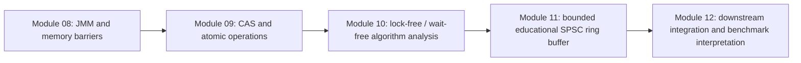

# Module 11 integration map — avoid cross-module collisions

## Project flow

This is a scope/handoff flow, not a claim that each module's code calls the next module.

## Boundary matrix

| Area | Module 11 action | Collision-avoidance rule |
|---|---|---|
| Main code | Add only `io.lnctqubit.hwconc.m11.SpscRingBuffer` | Do not reuse a generic `RingBuffer` class name in the root/default package. |
| Tests | Add only `io.lnctqubit.hwconc.m11.SpscRingBufferTest` | Do not alter earlier tests; run them as regression checks. |
| Maven | Reuse current Java 17/JUnit/JMH configuration | Do not add duplicate JUnit, Surefire, compiler, or JMH versions. No new runtime dependency is needed for the educational core. |
| Prior modules | Reference their concepts as prerequisites | Do not rewrite or copy their reports/implementations into Module 11. |
| CAS / atomics | No CAS in the SPSC core; each sequence has one writer | Do not relabel this as a CAS algorithm or reimplement Module 09. |
| Progress guarantees | Describe bounded-step `offer`/`poll` conservatively | Do not claim general lock-free/wait-free guarantees merely because no lock appears. |
| LMAX Disruptor | Source-grounded comparison only | Do not claim library API compatibility or features not implemented. |
| Results | Keep evidence in `results/raw/m11_*` | Never overwrite prior modules' raw output or copy old results as Module 11 evidence. |
| Downstream benchmark | Provide a proposal and PENDING template | Benchmark owner controls integration and must use raw reproducible results. |

## Safe merge checklist

- [ ] Diff the branch against the shared repository before merge.
- [ ] Confirm the canonical Project Contract and exact package conventions.
- [ ] Keep Module 11 additions in the paths listed above.
- [ ] Run `mvn clean test` from the repository root.
- [ ] Run repeated Module 11 stress tests and archive real output.
- [ ] Verify prior module tests still pass.
- [ ] Preserve all unverified status labels; do not convert generated documentation into execution evidence.
